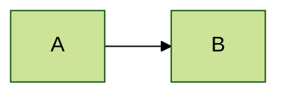

# ConvertMarkdown

Converts Markdown into a styled Word `.docx`, a PDF, or both — with mermaid
diagrams and Markdown images embedded as real pictures, and NextDocs extended
Markdown rendered rather than left as raw syntax.

**Version:** 2026.10.29 · **Requires:** PowerShell 7+ and Microsoft Word (desktop, Windows)

---

## Install

```powershell
git clone https://github.com/garethcheyne/PowerShell-Convert-Markdown.git
cd PowerShell-Convert-Markdown
.\Install.ps1
```

That places the module on `PSModulePath`, so `Convert-Markdown` autoloads from
**any directory**. No `Import-Module`, no per-repo copies.

The installer checks for Word, probes the diagram service, and offers to create a
style file.

While developing the module itself, install a symlink so edits take effect
immediately:

```powershell
.\Install.ps1 -Link -Force
```

### Updating

`Install.ps1` copies from whatever folder you run it in — it does **not** fetch
anything. Re-running it reinstalls that same local copy.

To pull the latest published version:

```powershell
Update-ConvertMarkdown -CheckOnly   # what's available, changes nothing
Update-ConvertMarkdown              # fetch and replace if newer
```

It downloads the branch archive over HTTPS, compares versions, and only replaces
the module when the available one is newer (`-Force` overrides). No git client
required. If you installed with `-Link` it will tell you to `git pull` in your
working copy instead, rather than overwriting uncommitted work.

---

## Use

```powershell
# Word document next to the source
Convert-Markdown .\CHANGELOG.md

# PDF, with a table of contents
Convert-Markdown .\design.md -Format Pdf -TableOfContents

# Both formats at once
Convert-Markdown .\design.md -Format Both -Force

# Try it on the samples in examples/
Convert-Markdown .\examples\extended-markdown.md -Format Both -Force

# Every markdown file in the folder
Get-ChildItem *.md | Convert-Markdown -Format Pdf -Force

# Leave it open in Word to check before sending
Convert-Markdown .\proposal.md -Open
```

Aliases: `md2docx`, `md2pdf`, and `Convert-MarkdownToWord`.

---

## Styling

The module ships deliberately neutral defaults. Colours, fonts and margins live
in a **style file**, so you never edit the module to rebrand output.

```powershell
# Starter file with every setting at its default - doubles as the reference
New-ConvertMarkdownStyle

# Per-project style, picked up automatically for documents in that folder
New-ConvertMarkdownStyle -Path .\.convertmarkdown.json -Name 'Project docs'
```

[**`style.example.json`**](style.example.json) in this repo is a complete file
with every option at its default — copy it as a starting point.
[**`style.schema.json`**](style.schema.json) is a JSON Schema, so editors that
understand `$schema` (VS Code among them) give you completion, hover
descriptions and validation as you type. Generated files carry the reference
automatically.

### Every option

| Key | Default | What it does |
| --- | --- | --- |
| `name` | `Default` | Label for the style. Reported back on the result object, so you can tell which file was used. |
| `theme` | — | A theme to build on — see [Themes](#themes). |
| `page.marginMm` | `10` | Margin in millimetres, all four sides. Header and footer sit at half this, floored at 8pt. |
| `page.orientation` | `Portrait` | `Portrait` or `Landscape`, title page included. |
| `fonts.body` | `Segoe UI` | Body text, running header and footer. |
| `fonts.heading` | `Segoe UI Semibold` | Headings h1–h3. |
| `fonts.title` | `""` | Title page headline. Empty means the heading font. |
| `fonts.mono` | `Consolas` | Code blocks and inline code. |
| `fonts.bodySizePt` | `10.5` | Body size in points. Headings scale independently. |
| `colours.accent` | `#1F3864` | h1/h2 text (unless `heading` is set), the filled table header, the title page kicker. |
| `colours.accentSoft` | `#2E74B5` | h3 text and the left rule on code blocks. |
| `colours.heading` | `""` | h1/h2 and title page headline. Empty means `accent`. |
| `colours.muted` | `#595959` | Rule-style table labels, title page standfirst and field labels. |
| `colours.rule` | `#C8102E` | The heavy rule beneath the document title. |
| `colours.border` | `#B4C6E7` | Table borders, horizontal rules, blockquote bar, h2 underline. |
| `colours.band` | `#F2F5FA` | Alternating table row background. |
| `colours.text` | `#1F1F1F` | Body text. Near-black prints better than pure black. |
| `tables.headerStyle` | `filled` | `filled`: accent header row, boxed cells. `rule`: small uppercase labels over a rule, hairline rows. |
| `cover.enabled` | `false` | Add a title page without `-TitlePage`. |
| `cover.logo` | `""` | PNG/JPG for the title page, relative to the file naming it. Empty draws an accent bar. |
| `cover.logoWidthMm` | `55` | Logo width; height follows its proportions. |
| `cover.kicker` | `""` | Label above the title when the frontmatter has no `kicker`. |
| `cover.band` | `""` | Title page panel colour. Empty means `colours.band`. |
| `cover.fields` | `[]` | Frontmatter keys along the bottom of the title page, in order. Empty shows them all. |
| `diagrams.service` | `mermaid.ink` | `mermaid.ink`, `kroki`, or `none`. |
| `diagrams.serviceUrl` | `""` | Base URL of a self-hosted renderer. Empty means the public endpoint. |
| `diagrams.maxWidthPx` | `640` | Max diagram width. 640 is the A4 text width at 96dpi. Also capped to page height. |
| `diagrams.theme` | `base` | Mermaid theme. Only `base` honours your palette — see below. |
| `diagrams.matchDocumentPalette` | `true` | Style diagrams from your palette so they match the document. |
| `images.maxWidthPx` | `640` | Max embedded image width. Wider images scale down, aspect ratio preserved. |
| `images.allowRemote` | `true` | Download and embed images referenced by `http(s)` URL. `false` skips them with a warning. |

### Diagram styling

By default a mermaid diagram arrives in mermaid's own mauve-on-beige colours and
looks pasted in from another document. `matchDocumentPalette` fixes that by
mapping your palette onto mermaid's theme variables:

| Your style | Mermaid |
| --- | --- |
| `colours.band` | node fill |
| `colours.accent` | node border |
| `colours.accentSoft` | edges |
| `colours.text` | labels |
| `colours.border` | clusters and secondary nodes |
| `fonts.body` | diagram font |

**This only works with `theme: "base"`.** The named themes (`neutral`, `dark`,
`forest`, `default`) ignore theme variables entirely, so setting one of those
silently discards your palette.

**Per-diagram control wins.** A diagram carrying its own `%%{init: ...}%%`
directive is sent untouched — explicit authoring beats the document default:

````markdown

````

`colors` is accepted as an alias for `colours`.

### Partial overrides

**A style file only needs the keys it changes.** Everything else falls back, so
these are both valid and complete files:

```json
{ "colours": { "accent": "#7A0026" } }
```

```json
{
  "name": "Confidential",
  "diagrams": { "service": "none" }
}
```

That second one is worth knowing about: drop it at `~/.convertmarkdown/style.json`
and no diagram source ever leaves the machine unless you deliberately override
with `-DiagramService` on a specific run.

> **A font you name must be installed on the machine doing the conversion**, or
> Word substitutes one. If your documents contain ASCII diagrams, be aware that
> Consolas covers the box-drawing block (`─ │ ├ └`) but **not** arrowheads like
> `►` `▼` `↘`. Word substitutes a proportional font for just those characters and
> the alignment shears. Stick to `> v \` in ASCII art, or use mermaid.

**Resolution order**, first match wins:

| | Source |
| --- | --- |
| 1 | `-StyleSheet <path>` |
| 2 | `$env:CONVERTMARKDOWN_STYLE` |
| 3 | `.convertmarkdown.json` beside the document |
| 4 | `~/.convertmarkdown/style.json` |
| 5 | Built-in defaults |

Explicit parameters (`-Margin`, `-Accent`, …) always win over the style file.

**Formats:** `.json` works out of the box. `.psd1` uses
`Import-PowerShellDataFile`. `.yaml` / `.yml` need the `powershell-yaml` module.

### Themes

A **theme** is a style you share across machines and documents, with its assets:
a folder holding `theme.json` (any style keys) and the files it names, such as a
logo. Brand themes are usually private, so they live **outside** the module:

```text
theming/                  <- in your clone, gitignored: never committed
  acme/
    theme.json
    logo.png
```

`Install.ps1` copies every folder under `theming/` to
`~/.convertmarkdown/themes/`, so a theme works from any directory however the
module was installed. To make one the default for every document on the machine:

```powershell
.\Install.ps1 -Force -DefaultTheme acme
# or, after installing:
New-ConvertMarkdownStyle -Theme acme -Force    # writes ~/.convertmarkdown/style.json = { "theme": "acme" }
```

The layers, lowest first: **built-in defaults → theme → style file → parameters.**
The theme comes from `-Theme`, else the style file's `"theme"` key, else
`$env:CONVERTMARKDOWN_THEME`. Because the style file sits on top, a style file that
lists every default (as `New-ConvertMarkdownStyle` without `-Theme` writes) hides
the whole theme — keep a theme-based style file to the keys that differ.

A theme is found by name in `$env:CONVERTMARKDOWN_THEMES` (a path list),
`~/.convertmarkdown/themes`, then the module's own `theming/` folder (useful with
`Install.ps1 -Link`). `-Theme` also takes a path to a theme folder or `theme.json`.

---

## Title page and orientation

```powershell
Convert-Markdown .\proposal.md -Format Both -TitlePage
Convert-Markdown .\proposal.md -Format Pdf -TitlePage -Orientation Landscape
```

`-TitlePage` (or `cover.enabled` in a style or theme) starts the document with a
full-bleed title page: the logo (or an accent bar), a small kicker, the title and a
standfirst on a tinted panel, and the remaining frontmatter fields along the bottom.
It has no running header; the body starts on page two with its usual header and
footer.

| On the title page | From |
| --- | --- |
| Title | frontmatter `title`, else the first `# heading` (which then leaves the body) |
| Standfirst | `subtitle`, else `excerpt` / `description` |
| Kicker | `kicker`, else `cover.kicker` |
| Fields | everything else in the frontmatter (`author`, `status`, `preparedFor` → *Prepared for*, …), or just `cover.fields`; today's date when there is none |

```yaml
---
title: Quote auto-close decision summary
excerpt: How quotes close automatically, and what we decided.
kicker: Decision summary
author: A. Writer
preparedFor: Sales Operations
status: Draft for review
---
```

`-Orientation Landscape` (or `page.orientation`) turns every page, title page
included. Portrait is the default. `-NoTitlePage` overrides a style that turns the
title page on.

---

## Parameters

| Parameter | Default | Notes |
| --- | --- | --- |
| `-Path` | — | Source `.md`. Accepts pipeline input. |
| `-Format` | `Docx` | `Docx`, `Pdf`, or `Both`. |
| `-OutputPath` | *alongside source* | With `-Format Both`, names the `.docx`; the PDF sits beside it. |
| `-StyleSheet` | *resolved* | Style file for this run. |
| `-Theme` | *resolved* | Theme name or path for this run. |
| `-TitlePage` | off | Start with a title page. |
| `-NoTitlePage` | off | No title page even if the style enables one. |
| `-Orientation` | `Portrait` | `Portrait` or `Landscape`. |
| `-Margin` | `10` | Page margin in millimetres, all four sides. |
| `-Accent` | `#1F3864` | Heading and table-header colour. |
| `-DiagramService` | `mermaid.ink` | `mermaid.ink`, `kroki`, or `none`. |
| `-DiagramServiceUrl` | — | Base URL of a self-hosted renderer. |
| `-DiagramMaxWidth` | `640` | Max diagram width in pixels. |
| `-ImageMaxWidth` | `640` | Max embedded image width in pixels. |
| `-NoRemoteImages` | off | Skip images referenced by `http(s)` URL. |
| `-ExcludeRestricted` | off | Drop NextDocs `!variant!` role-gated sections. |
| `-TableOfContents` | off | Insert a TOC after the title. |
| `-Open` | off | Leave open in Word instead of closing. |
| `-Force` | off | Overwrite existing output. |

Supports `-WhatIf`, `-Confirm` and `-Verbose`.

---

## Mermaid diagrams

` ```mermaid ` fenced blocks are rendered to PNG and embedded as pictures. Without
this they land in the document as a grey box full of `flowchart TD` source.

> ### Privacy — read this before using it on confidential documents
>
> `mermaid.ink` and the public `kroki.io` are **third-party services**. The source
> of every mermaid block is sent over the internet to be rendered, and may be
> cached or logged by the provider. Nothing else in the document is transmitted.
>
> For internal architecture or governance documents, choose one of:
>
> ```powershell
> # Nothing leaves the machine - a labelled placeholder box is inserted instead
> Convert-Markdown .\architecture.md -DiagramService none
>
> # Self-hosted renderer - diagram source stays inside your network
> Convert-Markdown .\architecture.md -DiagramService kroki `
>                  -DiagramServiceUrl https://kroki.internal.example
> ```
>
> Or set `diagrams.service` in your style file so the safe choice is the default.

**On the public Kroki instance:** it returns HTTP 500 or times out for mermaid
diagrams, and has done since at least 2026-08-02. `mermaid.ink` is the default for
that reason. Use `kroki` with `-DiagramServiceUrl` pointing at your own instance.

### If diagrams don't render

| Symptom | Cause |
| --- | --- |
| Raw `flowchart TD` in the document | The fence was not recognised. Check it is exactly ` ```mermaid ` with no trailing text. A warning is emitted when this happens. |
| `Diagrams = 0` on a file that has them | Older versions failed to match fences in **CRLF** files — `(?m)$` does not match before `\r\n`. Fixed: source is normalised to LF before parsing. |
| `failed to render via mermaid.ink` | Network, proxy, or a syntax error in the diagram. The source block is kept so nothing is lost. |

---

## Images

`` is embedded as a real picture. Word silently discards
`` from imported HTML, so without this images arrive as
empty placeholder boxes — the same problem mermaid blocks have, solved the same
way: a text token in the markup that `InlineShapes.AddPicture` replaces once the
document exists.

| Written as | Resolved |
| --- | --- |
| `` | Relative to the **document**, not the working directory |
| `` | Absolute path |
| `` | Percent-encoding is decoded |
| `` | Angle brackets stripped |
| `` | Title ignored, path used |
| `` | Downloaded to a temp file, unless `-NoRemoteImages` |

An image alone on its line is centred and kept off a page break. An image inside
a sentence stays inline. Alt text is written to the picture's `AlternativeText`,
which is what a screen reader announces and what Word's accessibility checker
looks for.

Images are **not** touched inside fenced code blocks or inline code, so a document
that documents Markdown keeps its examples as text.

A missing file leaves a visible `[image not found: …]` placeholder and emits a
warning; it never fails the conversion. `ImagesEmbedded` and `ImagesMissing` on
the result object report what happened.

> **Privacy**
> `-NoRemoteImages` stops image URLs being fetched. Pair it with
> `-DiagramService none` for a conversion that makes no network call at all.

---

## Extended Markdown (NextDocs)

[NextDocs](https://github.com/garethcheyne/NextDocs-AiSkills) extends Markdown with
`:::` blocks, inline directives and role-gated sections. All of it is understood
here — but the web renderer is interactive and a page is not, so each construct is
re-imagined as something that still reads when nothing can be clicked.

Nothing has to be enabled. If a document has none of this syntax, nothing changes.

### Frontmatter

YAML frontmatter becomes the document header, the way NextDocs renders it on the
web: `title` is the H1 — which is also what the running header and the `.docx`
Title property are taken from — `excerpt` is the standfirst, and everything else
joins the key/value box.

```markdown
---
title: Deploying the Example Service
excerpt: End-to-end deployment procedure, including rollback.
author: gareth-cheyne
tags: [deployment, runbook, example]
restricted: true
restrictedRoles:
  - Platform-Ops
---
```

Flat `key: value` pairs and `- item` lists are read. `draft: false` and
`restricted: false` are dropped rather than printed as rows. Follow the NextDocs
convention of starting the body at `##` and the title will not appear twice.

### Blocks

| Syntax | How it prints |
| --- | --- |
| `> [!NOTE]` … `[!CAUTION]` | Tinted panel with a coloured left bar, glyph and type label. GitHub's palette. |
| `:::steps` | Numbered disc in the gutter, step title in bold, body beneath. Each `###` is a step. |
| `:::tabs` | **Every** panel, in order, each under its own coloured label bar. |
| `:::details Summary` | Shown open, with the summary as its heading. |
| `:::filetree` | Monospace box-drawing tree; folders (trailing `/`) in bold. |
| `:::api GET /path` | Coloured method chip beside the path in monospace, details below. |
| `:::diff lang` | Monospace lines, additions green and removals red, filename in the header bar. |
| `:::gallery` · `3` · `3x2` | Picture grid at that column count (3 when unspecified); alt text becomes the caption. |
| `:::release` | Accent title bar with the version, a teams strip, then the notes. |

Tabs are the interesting case. On the web four of five panels are hidden behind
whichever tab is open; on paper that would silently delete four fifths of the
content, so all of them are printed and the tab label becomes a heading for each.
Collapsed `:::details` is expanded for the same reason.

The `+` and `-` markers stay in the text of a diff rather than being replaced by
colour alone, so the block still reads when printed in grey-scale or read aloud.

### Inline

| Syntax | How it prints |
| --- | --- |
| `:kbd[Ctrl+Shift+P]` | Boxed monospace key caps, one per key |
| `:badge[stable]` | Coloured pill, variant inferred from the word |
| `:badge[text]{variant}` | `default`, `success`, `warning`, `error`, `info`, `purple` |

### Restricted sections

`!variant!# ROLE … !endvariant!` marks content the website shows only to a role.
By default it is **printed**, behind a dashed *Restricted — ROLE* banner, and the
conversion warns you that the document carries it. `-ExcludeRestricted` drops it
instead — before diagrams are rendered, so a mermaid block inside a restricted
section is never sent to a rendering service either.

```powershell
Convert-Markdown .\internal-runbook.md -ExcludeRestricted
```

### Not supported

| Syntax | What happens |
| --- | --- |
| `:::sketch <id>` | A placeholder note. The drawing is a NextDocs database row, not part of the Markdown, so there is nothing in the file to render. |
| ` ```math ` and `` `$x$` `` | Kept as source. No LaTeX typesetting — a document that needs real equations wants a different tool. |
| `:#fluentui name:` | Removed. It is an icon font that is not in the document, and the name alone is noise. |
| `:icon-name:` (Lucide) | **Left as written.** The pattern is too close to ordinary prose — `10:30:00`, `ratio 3:2:1` — to strip without corrupting text. |
| YouTube links | Stay a hyperlink. No thumbnail is fetched. |
| Link-wrapped gallery images | The picture is kept, the link around it is not. |

### Counts on the result object

`ExtendedBlocks`, `Callouts` and `Restricted` report what was found, alongside the
existing image and diagram counts.

> Everything above is skipped inside fenced code blocks and inline code, so a
> document that *documents* this syntax keeps its examples as text.

---

## Examples

[`examples/`](examples/) holds sample documents to convert — a feature reference, a
realistic NextDocs page, a plain-Markdown baseline and a styling walkthrough. See
[examples/README.md](examples/README.md) for what each one covers.

```powershell
cd examples
Get-ChildItem *.md -Exclude README.md |
    Convert-Markdown -Format Pdf -Force -DiagramService none -NoRemoteImages
```

---

## Tests

```powershell
.\tests\Invoke-Tests.ps1                # fast: no Word, no network, ~1.5s
.\tests\Invoke-Tests.ps1 -IncludeWord   # adds the end-to-end conversions, ~1min
.\tests\Invoke-Tests.ps1 -CI            # NUnit XML, non-zero exit on failure
```

Needs [Pester](https://pester.dev) 5 or newer:

```powershell
Install-Module Pester -MinimumVersion 5.0 -Scope CurrentUser -Force -SkipPublisherCheck
```

The suite is split by tag. The default set is pure string-to-string checks over the
parsing and rendering functions and is what CI should gate on; the `Word`-tagged
set automates Word and is excluded automatically unless you ask for it.

**The corpus is `examples/*.md`.** That is deliberate — a construct nobody thought
to document is a construct nobody is testing either, so the suite asserts that
every block type, every callout type and every inline directive appears somewhere
in the examples and fails if one is missing. Deliberately malformed input lives in
`tests/fixtures/` instead, so the examples stay publishable.

---

## What it produces

- A4, **10mm margins** on all four sides (configurable)
- Running header with the document title and a hairline rule
- Footer with date, and `Page X of Y`
- Styled headings, banded tables, code blocks, blockquotes and task-list glyphs
- Markdown images embedded as real pictures, with alt text carried onto the shape
- NextDocs `:::` blocks, callouts, `:kbd[]`/`:badge[]` and frontmatter rendered
- `**Key:** value` lines above the first `---` collapse into a metadata table
- Table header rows repeat across page breaks; rows do not split mid-cell
- PDF output carries heading bookmarks and structure tags, so it is navigable
  and accessible

---

## Notes

Word automation means this is **Windows + Word desktop only**. There is no
LibreOffice or cross-platform path, and adding one would mean giving up the
fidelity that makes the output worth having.

Markdown is parsed by Markdig, built into PowerShell 7's `ConvertFrom-Markdown` —
no external parser to install.

---

## Licence

MIT. See [LICENSE](LICENSE).
