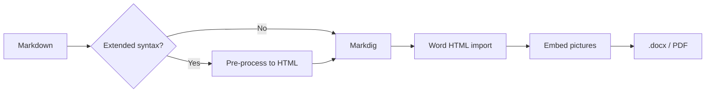

# Core Features

**Author:** ConvertMarkdown
**Version:** 2026.09.03
**Purpose:** Everything the converter does with ordinary Markdown

---

This file uses no extended syntax at all. It is the baseline: plain CommonMark plus
GitHub tables and task lists, converted with the module's default style.

The `**Key:** value` lines above the first `---` were collapsed into the key/value
box at the top of this page. That only happens for a run of two or more such lines
before the first horizontal rule — anywhere else they stay bold text.

## Headings

Headings run from `#` to `####`. The H1 sets the running header and the `.docx`
Title property, so a document should have exactly one.

### A third-level heading

Third-level headings use the softer accent colour and carry no rule.

#### A fourth-level heading

Fourth-level headings are body-sized and dark grey — a label, not a divider.

## Text

Ordinary paragraphs, with **bold**, *italic*, ***both***, ~~strikethrough~~ and
`inline code`. A [link to the repository](https://github.com/garethcheyne) is
rendered as a real Word hyperlink.

> A blockquote gets a left rule and softer text. It is the right shape for a
> quotation, a caveat or an aside that is not urgent enough for a callout.

## Lists

Unordered:

- First item
- Second item
  - A nested item
  - Another nested item
- Third item

Ordered:

1. Prepare the input
2. Run the conversion
3. Check the output

Task lists become printable box glyphs rather than Word form fields:

- [x] Convert to `.docx`
- [x] Convert to PDF
- [ ] Convert to something else

## Tables

Header rows repeat across page breaks and rows are banded. Rows never split
mid-cell.

| Parameter | Default | What it does |
| --- | --- | --- |
| `-Format` | `Docx` | `Docx`, `Pdf`, or `Both` |
| `-Margin` | `10` | Page margin in millimetres |
| `-Accent` | `#1F3864` | Heading and table-header colour |
| `-TableOfContents` | off | Insert a TOC after the title |
| `-Open` | off | Leave the document open in Word |

Alignment is honoured:

| Left | Centre | Right |
| :--- | :---: | ---: |
| one | two | three |
| a longer cell | mid | 42 |

## Code

Fenced blocks keep their language for reference and get a left accent rule:

```powershell
Import-Module ConvertMarkdown
Get-ChildItem *.md | Convert-Markdown -Format Pdf -Force
```

```json
{
  "name": "house",
  "fonts": { "body": "Segoe UI", "bodySizePt": 10.5 },
  "colours": { "accent": "#1F3864" }
}
```

Indented code works too:

    $style = New-ConvertMarkdownStyle -Path .\style.json
    Convert-Markdown .\doc.md -StyleSheet .\style.json

## Images

An image alone on its line is centred and kept off a page break:


An image  inside a sentence stays inline at its
natural size, capped by `-ImageMaxWidth`.

Alt text is written to the picture's `AlternativeText`, which is what a screen
reader announces and what Word's accessibility checker looks for.

## Diagrams

Mermaid blocks are rendered to PNG and embedded as pictures. This one needs
network access — convert with `-DiagramService none` to skip it and leave a
placeholder instead.



## Horizontal rules

Three or more dashes on their own line:

---

...produce a hairline rule in the border colour.
