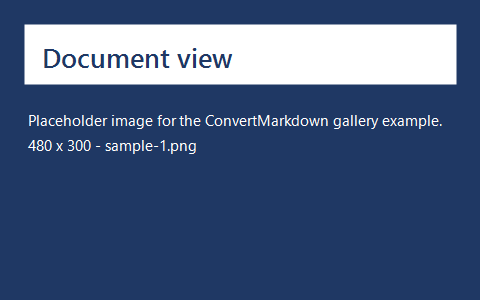
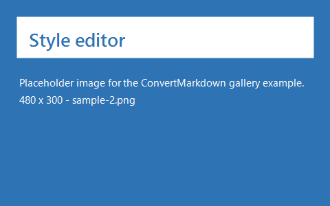
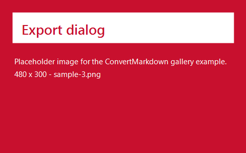

Convert this file to see the whole extended-Markdown feature set at once:

```powershell
Convert-Markdown .\extended.example.md -Format Both -Force
```

Everything above this line came from the YAML frontmatter. `title` became the H1 —
which is also the running header and the `.docx` Title property — `excerpt` became
the standfirst, and the remaining fields the key/value box. Following the NextDocs
convention, the body starts at `##` so the title is not repeated.

---

## Callouts

GitHub-style alerts become tinted panels with a coloured bar, a glyph and a label.

> [!NOTE]
> Useful information that a reader should know.

> [!TIP]
> Helpful advice for doing things better.

> [!IMPORTANT]
> Key information the reader needs before continuing.

> [!WARNING]
> Urgent information that needs immediate attention.

> [!CAUTION]
> Advises about risk, or a negative outcome.

## Steps

Each `###` inside the block becomes a numbered step: a filled disc in the gutter,
the title in bold, the body beneath it.

:::steps
### Install the module
Run `Install.ps1`, or copy the module folder onto your `PSModulePath`.

### Write a style file
`New-ConvertMarkdownStyle -Path .\style.json` gives you every setting at its
default, ready to edit.

### Convert
Point `Convert-Markdown` at a file. The output lands beside the source unless
`-OutputPath` says otherwise.
:::

## Tabs

On the web, four of these five panels are hidden behind whichever tab is open.
Hiding them on paper would delete most of the content, so every panel is printed
and each label becomes its own heading.

:::tabs
@tab PowerShell Gallery
Not published yet — install from source.

@tab From source
Clone the repository and run `.\Install.ps1`.

@tab Manual
Copy `ConvertMarkdown.psm1` and `ConvertMarkdown.psd1` into a folder named
`ConvertMarkdown` on your `PSModulePath`.
:::

## Details

A disclosure triangle has nothing to disclose in print, so the panel is shown open
with its summary kept as the heading it already is on the web.

:::details Why Word automation rather than a converter library?
Fidelity. Real embedded pictures, repeating table header rows, heading bookmarks
and structure tags in the PDF are all things Word does properly and a standalone
converter does not. The cost is that this runs on Windows only.
:::

## File tree

The web draws indent guides. Print gets the box-drawing tree everyone already
reads in terminal output — no colour needed, and it survives photocopying. A
trailing `/` marks a folder and is rendered in bold.

:::filetree
- ConvertMarkdown/
  - ConvertMarkdown.psd1
  - ConvertMarkdown.psm1
  - Install.ps1
  - style.example.json
  - style.schema.json
- docs/
  - _img/
    - diagram.png
  - index.md
- README.md
:::

## API endpoints

The method becomes a colour-coded chip beside the path. Content above the `---`
is the description; content below it is the detail.

:::api GET /documents/:id
Retrieve a single document and its metadata.
---
**Path parameters:**

- `id` (string) — the document's unique identifier

**Response:** the document body plus its frontmatter fields.
:::

:::api POST /documents
Create a document.
:::

:::api DELETE /documents/:id
Permanently remove a document. This cannot be undone.
:::

## Code diffs

Additions are tinted green and removals red — but the `+` and `-` markers stay in
the text, so the block still reads when the page is printed in grey-scale or read
aloud by a screen reader.

:::diff powershell
filename: ConvertMarkdown.psm1
---
  $markdown = Get-Content -LiteralPath $source -Raw -Encoding UTF8
- $body = (ConvertFrom-Markdown -InputObject $markdown).Html
+ $nd = Expand-NdBlock -Markdown $markdown -ImageAlt $imageAlt
+ $body = (ConvertFrom-Markdown -InputObject $nd.Markdown).Html
  $html = $head + $body + $foot
:::

## Galleries

Images are laid out on a grid at the requested column count and their alt text
becomes the caption. `:::gallery` on its own uses three columns; `:::gallery 2`
uses two; `:::gallery 3x2` fixes both dimensions.

:::gallery 3



:::

:::gallery 2


:::

## Release notes

:::release
teams: Documentation, Platform
version: 2026.09.03.1
---
### Added
- NextDocs extended Markdown is rendered rather than passed through as raw syntax.
- YAML frontmatter becomes the document header.
- `-ExcludeRestricted` drops role-gated sections.

### Fixed
- Gallery pictures are sized to their column instead of the page width.
:::

## Inline directives

Press :kbd[Ctrl+Shift+P] to open the command palette, then :kbd[Enter] to run.
Save with :kbd[Ctrl+S].

Feature status: :badge[stable], :badge[beta], :badge[deprecated], :badge[new],
:badge[internal], and an explicit variant :badge[custom]{purple}.

The variant is inferred from the word when you do not give one — `stable` and
`released` are green, `deprecated` and `breaking` red, `beta` and `preview` amber,
`new` and `updated` blue, `internal` and `draft` purple.

## Restricted sections

The block below is role-gated. By default it is printed behind a dashed banner and
the conversion warns you the document carries it. `-ExcludeRestricted` drops it
instead — before diagrams are rendered, so a mermaid block inside a restricted
section is never sent to a rendering service either.

!variant!# Platform-Ops
Production credentials live in the operations secret store. Rotation is quarterly and
tracked in the operations calendar.
!endvariant!

Text after the block is visible to everyone again.

## Not rendered

A sketch is drawn in NextDocs and stored as a database row, not in the Markdown,
so there is nothing in this file to draw. It becomes a note saying so.

:::sketch 0f8fad5b-d9cb-469f-a165-70867728950e
Deployment topology
:::

Block and inline maths are kept as source rather than typeset:

```math
E = mc^2
```

## Examples stay examples

Everything above is skipped inside fenced code blocks and inline code, so a
document that *documents* this syntax keeps its examples as text. None of the
following is converted:

````markdown
:::steps
### This stays as written
:::

> [!NOTE]
> So does this.

Press :kbd[Ctrl+S] and check the :badge[status]{info}.
````

Inline code is protected too: `:kbd[Ctrl+S]`, `:badge[beta]{warning}` and `:::api`
all stay literal here.

## Task lists

- [x] Callouts, steps, tabs, details, filetree, api, diff, gallery, release
- [x] Frontmatter lifted into the document header
- [x] `:kbd[]` and `:badge[]`
- [ ] Sketches — not possible offline, by design
