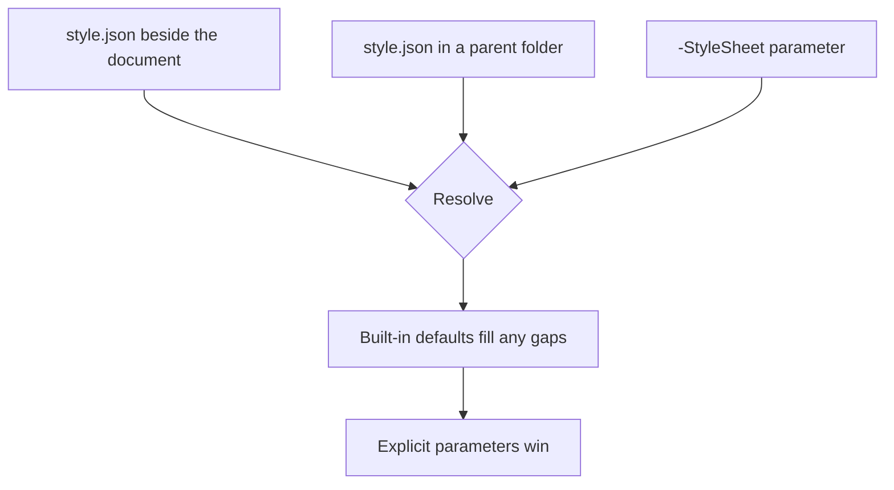

# Styling Reference

**Style file:** `style.example.json`
**Accent:** `#1F3864`
**Purpose:** See what each palette key actually controls

---

Convert this file twice and put the two PDFs side by side. Every difference you
can see is a palette key:

```powershell
Convert-Markdown .\styled.md -OutputPath .\styled-default.pdf -Format Pdf -Force
Convert-Markdown .\styled.md -OutputPath .\styled-crimson.pdf -Format Pdf -Force -Accent '#7A1F3D'
```

## What each key controls

Every element below is on this page, so you can point at the colour you want to
change and find its key.

| Key | Controls |
| --- | --- |
| `colours.accent` | H1 and H2 text, the table header background, the release bar |
| `colours.accentSoft` | H3 text, the left rule on code blocks, tab and details labels |
| `colours.rule` | The heavy rule beneath the document title — the one under "Styling Reference" |
| `colours.border` | Table borders, horizontal rules, blockquote bar, the H2 underline |
| `colours.band` | Alternating table rows, and the background of label strips |
| `colours.text` | Body text. Near-black prints better than pure black |
| `fonts.body` | Everything that is not a heading or code |
| `fonts.heading` | H1, H2 and H3 |
| `fonts.mono` | Code, file trees, diffs, API paths and key caps |
| `fonts.bodySizePt` | Body size. Headings scale independently of it |

### A third-level heading

This uses `accentSoft`, and has no rule under it. Compare it with the H2 above,
which uses `accent` and is underlined in `border`.

## Table shading

The header row is `accent`; alternate rows are `band`; every border is `border`.

| Environment | Region | Replicas | Status |
| --- | --- | ---: | --- |
| Production | region-a | 6 | Healthy |
| Staging | region-a | 2 | Healthy |
| Development | region-b | 1 | Degraded |
| Sandbox | region-b | 1 | Healthy |

## Code and rules

Code blocks take their left rule from `accentSoft` and their font from
`fonts.mono`:

```powershell
$style = @{
    colours = @{ accent = '#7A1F3D'; accentSoft = '#A64D6B' }
    fonts   = @{ body = 'Calibri'; heading = 'Calibri Light' }
}
```

A blockquote takes its bar from `border`:

> The default palette is deliberately conservative. It is meant to look like a
> document somebody wrote, not like output from a tool.

A horizontal rule uses `border` as well:

---

## Extended blocks follow the palette too

Callouts keep GitHub's semantic colours — a warning has to look like a warning
regardless of your accent — but everything structural around them follows the
style file.

> [!NOTE]
> Callout colours are fixed by type, on purpose.

Steps take their disc colour from `accent`:

:::steps
### Pick an accent
Anything with enough contrast against white at 10.5pt.

### Derive the soft accent
A lighter tint of the same hue reads best for H3 and code rules.

### Leave the rule colour alone unless you mean it
`colours.rule` is the single heavy line under the title. It is the one place a
contrasting colour earns its place.
:::

Tab and details labels use `accentSoft` and `band`:

:::tabs
@tab Style file
Put `style.json` beside the document, or in a parent folder, and it is picked up
automatically.

@tab Parameter
`-StyleSheet .\style.example.json` overrides whatever would have been found.

@tab Inline
`-Accent '#7A1F3D'` overrides just the accent, without a file.
:::

A release bar uses `accent` at full strength:

:::release
teams: Documentation
version: 2026.09.03.1
---
Palette keys are documented in `style.schema.json`, which gives editor
completion and validation if your editor honours `$schema`.
:::

## Diagrams

With `diagrams.matchDocumentPalette` set — it is on by default — a mermaid diagram
is rendered in your palette instead of mermaid's mauve-on-beige. Convert with
`-Accent '#7A1F3D'` and watch this diagram change with the rest of the page.



Set `diagrams.theme` to anything other than `base` and the palette is ignored —
named mermaid themes carry their own colours and silently discard the variables.
