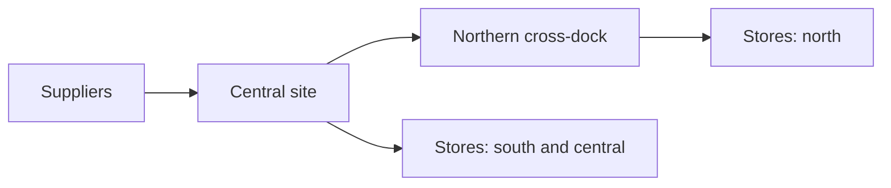

:kicker[Summary]

## Executive summary

:::lead
This sample shows a report built from plain Markdown with the Umbrella Corporation sample theme. The company and every figure in it are invented, so treat it as a layout example and nothing more.
:::

:::stats
Sites | 3 → 1 | regional warehouses replaced by one central site
Coverage | 2 days | delivery promise to every store in the network
Stock | −12% | safety stock once the sites are combined
Payback | 18 months | on the fit-out, in the central case
:::

:::columns
### What we found

- Each warehouse holds its own safety stock, so the same lines sit in three places.
- Most orders already leave **within a day** of the request.
- Stores order on different days, which makes transport planning harder.

---

### What we recommend

- Move to **one central site**, keeping the northern site as a cross-dock.
- Set one ordering calendar for all stores.
- Run a **three-month pilot** on the two largest product groups first.
:::

:kicker[Approach]

## How the move works

:::strip
Step 1 | Plan | Confirm the site, the fit-out, and the order of the moves
Step 2 | Prepare | Fit out the central site and train the team
! Gate | Decide | The pilot results decide whether to carry on
Step 3 | Pilot | Move two product groups and measure the service
Step 4 | Move | Move the remaining groups, one site at a time
Step 5 | Close | Hand back the leases and review the savings
:::

The diagram below comes from a Mermaid block, in the theme's colours.



> [!NOTE] Why one site
> Combining the sites removes duplicate safety stock, and that is where most of the saving comes from. Transport costs rise slightly, which the figures allow for.

:kicker[Risk]

## Risks and how we manage them

| Risk | What it means | How we manage it |
| --- | --- | --- |
| Service dips during the move | Stores wait longer for stock | Move one site at a time, and keep the old site open until the service holds |
| Northern delivery times | A longer trip to the northern stores | Keep a cross-dock in the north |
| Staff retention | Experienced people may not relocate | Agree retention terms before the announcement |

**Decisions needed:**

- [ ] Which site becomes the central one?
- [ ] Which two product groups go first in the pilot?
- [x] Should the northern site stay as a cross-dock?

Code samples use the theme's colours too, such as `order_no` inline, and this block:

```text
+-----------+      +--------------+      +--------+
| Suppliers | ---> | Central site | ---> | Stores |
+-----------+      +--------------+      +--------+
```

For more about the syntax, see the [examples guide](README.md).
